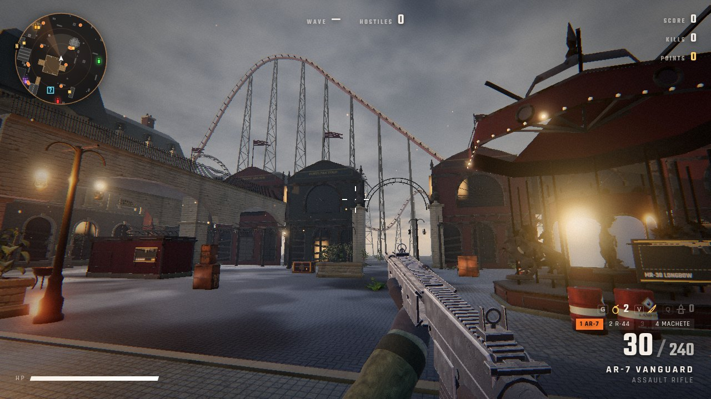
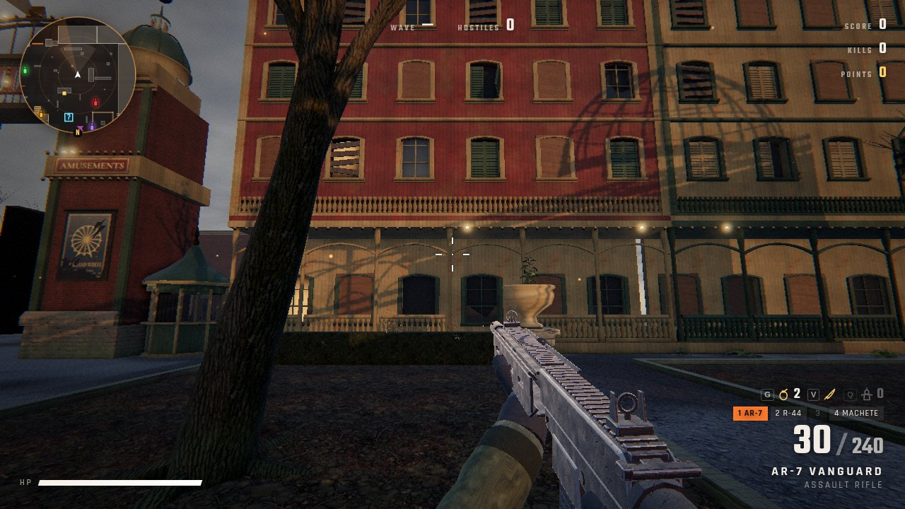
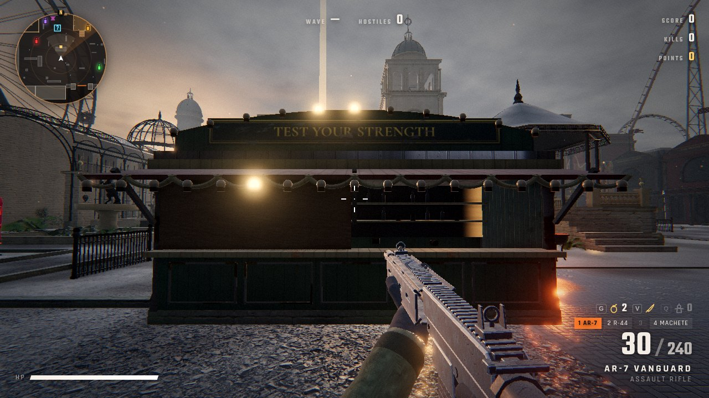

# ASHLAND

A horde shooter in the browser, set in Ashland: a grand amusement park that closed one wet evening and never
opened again. Built on three.js and WebGL shaders.

ASHLAND is a **setting reskin of [Hordefall](https://github.com/madhatter2727/hordefall)**. The guns, movement,
perks, shop, wall-buys, horde AI, enemies and throwables are Hordefall's, unchanged, except that mouse look is about 1.6x faster. The world is new.

**Play:** https://ashland-lac.vercel.app



## The park
- **The main gate** (south): a classic park entrance. Two painted timber pylons carry faded attraction bills
  under glass, a RIDES / AMUSEMENTS band and copper cupolas with gold globes. An iron arch spells ASHLAND in
  bulb letters, most of them dead. Octagonal ticket booths stand either side, with a row of rusted turnstiles
  behind.
- **The boardwalk hotels** either side of the gate: Hotel Meridian, The Carlisle, Hotel Vesper and The
  Belvedere. They are painted clapboard in oxblood, forest green and cream, with deep porches, turned posts
  and fretwork, plywooded windows, slate mansards, and painted name boards. Hotel Vesper has a dead neon
  sign and VACANCY on an iron lattice.
- **The Palace of Hours** (north): the park's great dark ride. The show halls are brick and wood, with
  boarded arcades, poster cases, faded murals and stepped false fronts with painted attraction boards. Over
  the gate, the clock tower (stopped at 11:47) carries a huge broken marquee whose east end has torn loose
  and sags. There are ticket windows in the tower piers and ticket kiosks out front.
- **The Midway** (east): game halls under an iron colonnade, a row of painted game booths (counters, prize
  shelves, awnings with scalloped valances, crest boards and dead bulbs), and a gilded carousel standing
  still under a torn velvet canopy. The steel skeleton of the great coaster rises over the wall. The coaster
  is scenery only.
- **The Grand Wheel** (west skyline): a 44 m riveted Ferris wheel, stopped. Some cars are missing, and one
  lies in the weeds.
- **The Gardens** (west): an iron-and-glass orangery, a dry reflecting pool with a dark bronze horse, overgrown
  hedges and dead trees.
- **The centre**: a marble bandstand terrace, iron queue rails, iron gas lamps, braziers, and puddles on dark
  wet paving.
- **Locked areas** (buy with F): **The Clock Terrace** (a stone terrace before the Palace, up a stair behind a
  chained iron gate) and **The Grotto** (the old rock-cut boat-ride hall behind an iron-banded shutter).

| | |
|---|---|
|  |  |
|  |  |

## How it looks the way it does
- All surfaces use Poly Haven CC0 PBR texture sets (albedo, normal, AO/roughness/metal) for herringbone paving,
  marble, sandstone, red brick, slate, painted clapboard, plywood, peeling murals, verdigris copper, rusted
  iron and velvet. They are
  box-projected in world space, so texel density stays the same on every piece.
- The architecture is procedural and modelled, not boxes: lathed columns with fluting, entasis and capitals,
  extruded cornices and string courses, arches with keystones, pediments, balustrades, mansards with
  dormers, domes with ribs and lanterns, and iron railings. Static pieces are merged per material.
- Real CC0 models: iron gates, statues, lion heads, lanterns, a chandelier, urns, benches, shrubs, weeds,
  ferns and mossy rocks. The heaviest models are decimated so the game stays smooth on laptop GPUs.
- One shared weather shader adds grime and damp rising from the ground, rain streaks under ledges, moss on
  upward-facing stone, wet sheen, gold leaf flaking off the gilding, and puddles with animated rain ripples.
- Lighting is an overcast dusk HDRI (kloppenheim_01_puresky) for image-based lighting and reflections, a
  low sun behind the Palace, a slate cloud deck, rain haze and fog, and warm failing gas lamps.

## Controls
| | |
|---|---|
| WASD | move |
| Shift | sprint |
| C / Ctrl | crouch (slide while sprinting) |
| Space | jump |
| Left mouse | fire |
| Right mouse | aim down sights |
| R | reload |
| 1 / 2 / 3, mouse wheel | switch weapon |
| Esc | pause |

## Weapons
- **AR-7 Vanguard**: full-auto assault rifle with iron sights and a learnable recoil pattern.
- **KS-12 Breacher**: pump shotgun with 10 pellets, shell-by-shell reload you can interrupt by firing, and iron sights.
- **MR-30 Longbow**: semi-auto marksman rifle that pierces one target. It has a collimated red-dot sight drawn by a shader, so the dot appears only through the glass.

## Tech
- Viewmodel rendered in its own scene. Spring-damper kick, sway, inertia and bob; heavier guns move slower.
- Two recoil layers: aim recoil that recovers over time, and a separate visual camera kick.
- Hitscan with head, body and limb zones, damage falloff, hit, headshot and kill markers, damage numbers, and hitstop on kills.
- Enemies are 15-joint skeletons drawn with instanced meshes. They run a procedural gait, flinch and stagger when hit, and turn into Verlet ragdolls with a dissolve shader on death.
- Horde AI: a flow field over a navigation heightmap, flanking, separation steering, and leaps onto high ground.
- Post chain: GTAO (high quality only), bloom, ACES tone mapping, color grade, vignette, damage vignette.
- Audio is layered WebAudio synthesis with a convolution reverb tail.

```
npm install
npm run dev
```
