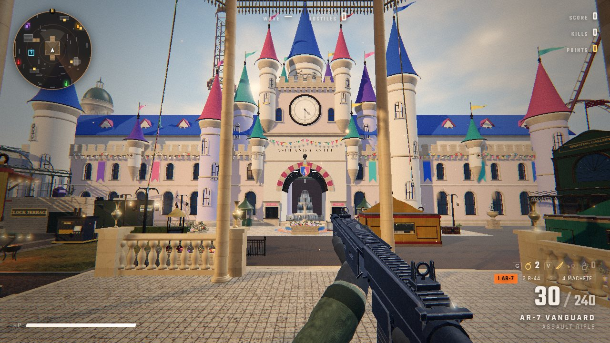
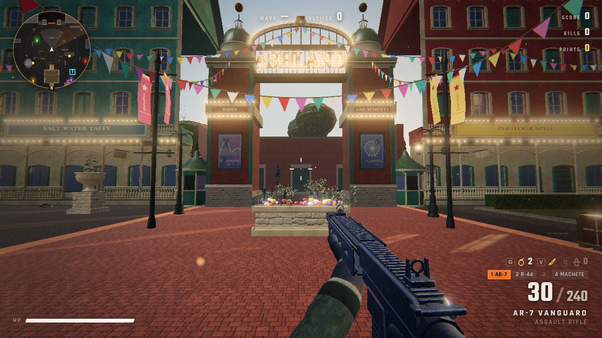
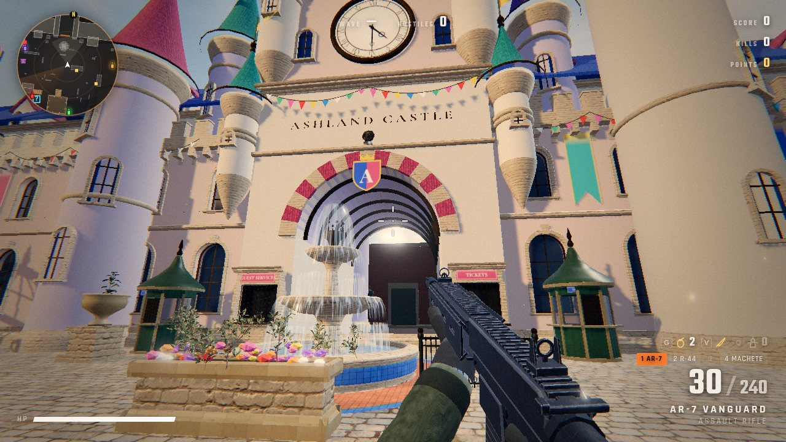
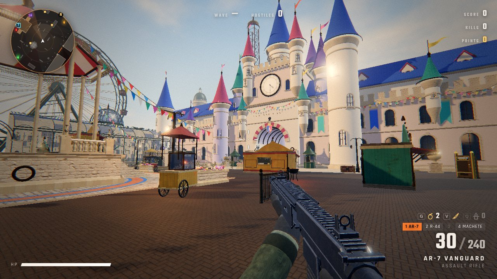
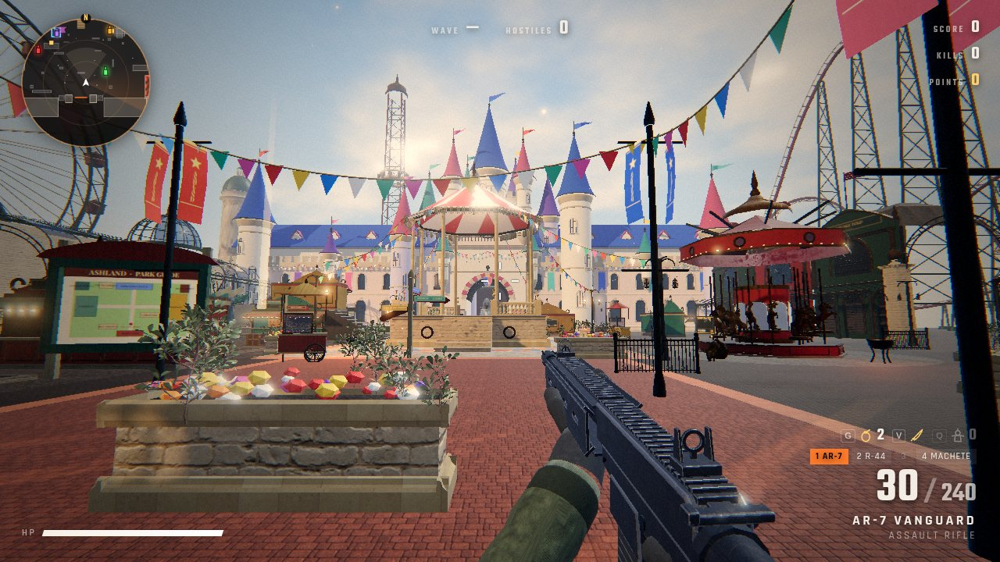

# ASHLAND

A horde shooter in the browser, set in Ashland, a fairy-tale theme park on a late autumn afternoon, with the
horde coming in through the gates. Built on three.js and WebGL shaders.

ASHLAND is a **setting reskin of [Hordefall](https://github.com/madhatter2727/hordefall)**. The guns, movement,
perks, shop, wall-buys, horde AI, enemies and throwables are Hordefall's, unchanged, except that mouse look is about 2x faster. The world is new.

**Play:** https://ashland-park.vercel.app (also https://ashland-lac.vercel.app)



## The park
- **The main gate and Main Street** (south): two painted pylons with RIDES and AMUSEMENTS bands carry an
  iron arch that spells ASHLAND in lit bulb letters, with ticket booths and turnstiles. Main Street runs from
  the gate to the hub on warm brick paving, under swags of bunting strung between banner poles, past the
  boardwalk lodges in sunny yellow, teal, carnival red and cream: steep shingle gables, deep porches, and
  shops on the ground floors (Souvenirs, Salt Water Taffy, Photographs and a Penny Arcade). Hotel Vesper's
  neon script is lit.
- **Ashland Castle** (north): the park's fairy-tale castle, an original design. Pastel lime-stucco walls in
  blush, cream and lilac with tall arched cobalt-glass windows, white stone trim and a clean crenellated
  crown; slender round towers of different heights with flared glazed-tile cone roofs (cobalt, rose, teal,
  plum), gilt finials and pennants; corbelled bartizans; a long hall behind the wall with dormers; and over
  the gate a three-stage keep: the great arch with rose-and-white voussoirs, the park crest and gilt
  lettering, a clock stage (half past four), and a tall central spire. Heraldic banners and bunting hang
  from the walls. In the cobbled courtyard in front, a three-tier fountain with moving water.
- **The hub** (centre): colour-cobbles with terracotta and blue rings round a tall bandstand with a candy-striped
  roof, bunting strung from its eaves to the lamp standards, planters full of flowers, the park guide map,
  popcorn carts, and finger posts pointing to the rides and games.
- **The Midway** (east): game halls under an iron colonnade, painted game booths with lit prize shelves,
  scrolled crest boards and dead bulbs, and a gilded carousel standing still. The great coaster rises over
  the wall.
- **The Gardens and the flume** (west): an iron-and-glass orangery, and the dry splash pool of the old flume
  ride with a boat stranded in it under the broken trough.
- **On the skyline**, all scenery only: the Iron Comet coaster, the Grand Wheel (a stopped 44 m Ferris wheel),
  the Plummet (a 58 m drop tower with its seats stuck high), and the Sky Swings (a wave swinger jammed at a
  tilt).
- **Locked areas** (buy with F): **The Clock Terrace** (a stone terrace before the castle, up a stair behind a
  chained iron gate) and **The Grotto** (the old rock-cut boat-ride hall behind an iron-banded shutter).

| | |
|---|---|
|  |  |
|  |  |

## How it looks the way it does
- All surfaces use Poly Haven CC0 PBR texture sets (albedo, normal, AO/roughness/metal) for herringbone paving,
  marble, sandstone, red brick, slate, painted clapboard, plywood, peeling murals, verdigris copper, rusted
  iron and velvet. They are
  box-projected in world space, so texel density stays the same on every piece.
- The architecture is procedural and modelled, not boxes: lathed columns with fluting, entasis and capitals,
  extruded cornices and string courses, arches with keystones, pediments, balustrades, mansards with
  dormers, domes with ribs and lanterns, and iron railings. Static pieces are merged per material.
- Real CC0 models: iron gates, statues, lion heads, lanterns, a chandelier, urns, benches, shrubs, weeds,
  ferns and mossy rocks. The heaviest models are decimated so the game stays smooth on laptop GPUs.
- One shared weather shader can add grime, damp, rain streaks, moss, flaking gilt and puddles; the park is
  open and kept, so a single `UPKEEP` table in `src/world/park/materials.js` scales all of it way down.
- Lighting is late-afternoon daylight, and every number lives in one file, `src/world/lighting.js`: a warm
  sun 24 degrees up in the south-west raking the castle front, a blue sky with cumulus, a real partly-cloudy
  daylight HDRI (Poly Haven kloofendal_48d_partly_cloudy_puresky, CC0) for image-based light and
  reflections, blue skylight in the shadows, and a light haze. Nightfall still blends to night as the waves
  climb.

## Controls
| | |
|---|---|
| WASD | move |
| Shift | sprint |
| C / Ctrl | crouch (slide while sprinting) |
| Space | jump |
| Left mouse | fire |
| Right mouse | aim down sights |
| R | reload |
| 1 / 2 / 3, mouse wheel | switch weapon |
| Esc | pause |

## Weapons
- **AR-7 Vanguard**: full-auto assault rifle with iron sights and a learnable recoil pattern.
- **KS-12 Breacher**: pump shotgun with 10 pellets, shell-by-shell reload you can interrupt by firing, and iron sights.
- **MR-30 Longbow**: semi-auto marksman rifle that pierces one target. It has a collimated red-dot sight drawn by a shader, so the dot appears only through the glass.

## Tech
- Viewmodel rendered in its own scene. Spring-damper kick, sway, inertia and bob; heavier guns move slower.
- Two recoil layers: aim recoil that recovers over time, and a separate visual camera kick.
- Hitscan with head, body and limb zones, damage falloff, hit, headshot and kill markers, damage numbers, and hitstop on kills.
- Enemies are 15-joint skeletons drawn with instanced meshes. They run a procedural gait, flinch and stagger when hit, and turn into Verlet ragdolls with a dissolve shader on death.
- Horde AI: a flow field over a navigation heightmap, flanking, separation steering, and leaps onto high ground.
- Post chain: GTAO (high quality only), bloom, ACES tone mapping, color grade, vignette, damage vignette.
- Audio is layered WebAudio synthesis with a convolution reverb tail.

```
npm install
npm run dev
```
